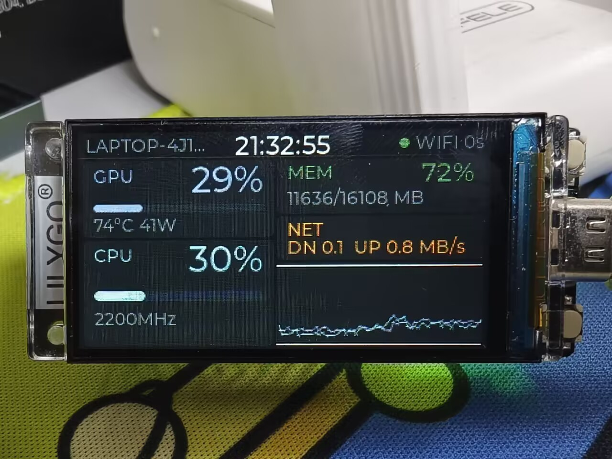
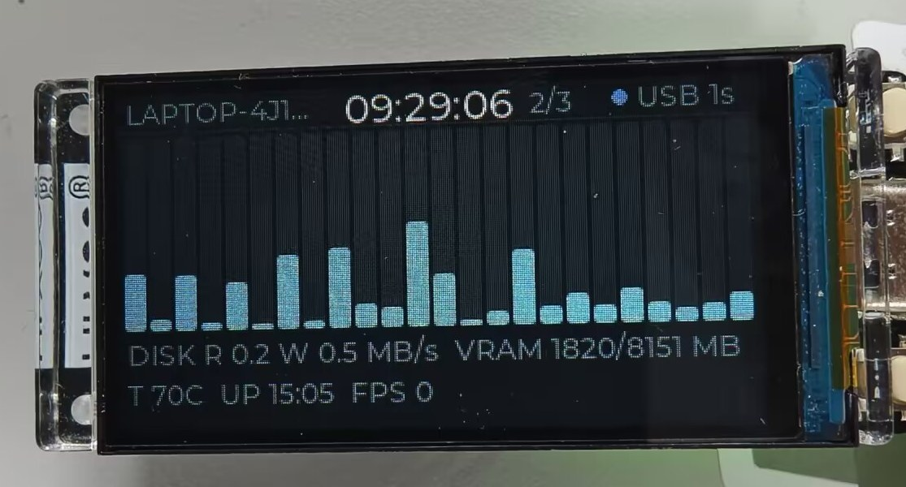
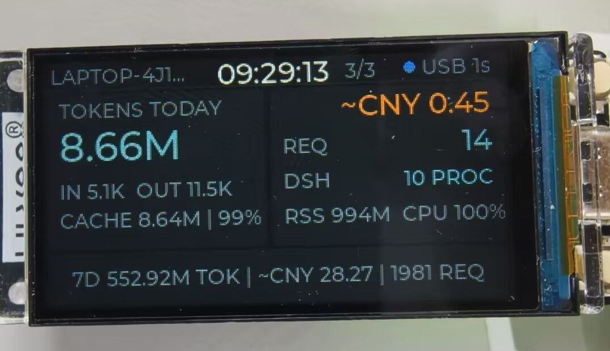

# T-Display-S3 PC Monitor

**把一块 1.9 寸的 ESP32-S3 开发板，做成放在桌角的电脑性能仪表盘。**

> **English TL;DR** — A 1.9″ 320×170 desktop dashboard for your PC, built on
> LilyGO **T-Display-S3** (ESP32-S3, 8-bit 8080 parallel ST7789, 16 MB flash).
> A Python host daemon (`pcmond`) samples CPU / RAM / GPU / network / disk every
> second and pushes one compact JSON line over **USB CDC** (HTTP + Wi-Fi as
> fallback). Firmware: ESP-IDF 5.5.3 + LVGL 9.2.2. Host: Python 3.10+. **License: MIT.**
> **Status:** the panel is **lit** and the USB live link is verified on hardware: the
> final ST7789 setup is `MV + MX + invert + RGB + gap(0,35)`, i80 PCLK runs at 16 MHz,
> and a floating LCD RD pin (GPIO9) turned out to be the cause of a half-white/half-garbled
> screen. Under load the host reads 97.5% CPU while the panel follows at 90%+.
> Wi-Fi mode and CPU temperature are still unverified — see
> [Verified / Unverified](#已验证--未验证).

> ✅ **项目状态（2026-11-10）**：**屏幕已点亮，USB 与 Wi-Fi 两条链路都已实机验证。**
> 320×170 横屏 UI 正常显示（用户确认「画面完全对了」）；最终 ST7789 参数 = V0
> **MV + MX + invert + RGB + gap(0,35)**，i80 PCLK 用官方 LilyGO 配置值 **16 MHz**。
> USB CDC 1 Hz 推帧、`seq` 连续递增；压 CPU 60 秒时 PC 端读 **97.5%**、屏上同步 90%+；
> 内存 / GPU / NET 读数与 PC 端 ground truth 一致。
> Wi-Fi 模式也跑通了：设备连 AP 拿到 DHCP 地址后每秒 HTTP 轮询 `/api/stats`，
> 把上位机切成「只用 HTTP」时屏幕数字照常实时刷新。
> 剩余未验证项只有 **CPU 温度读不到**（14 代 HX 需 MSR）、帧率实测、长时间稳定性等细项，见文末清单。

---

## 它能显示什么

横屏 **320×170**，**三页 UI**（KEY 短按循环）：P0 总览 / P1 线程明细 / **P2 DSH 用量**。
顶栏显示主机名 / 时间 / 链路状态点，四张指标卡片 + 60 点历史曲线。

**实机照片**（跑在 T-Display-S3 上，亚克力外壳是成品自带的；当时链路走 Wi-Fi，`seq` 延迟 0 s）：



上图中 GPU 走的是 `nvidia-smi` 的真实读数（占用率 / 温度 / 功耗），CPU 频率来自 `psutil`；
NET 空闲时低到 `DN 0.1 UP 0.8 MB/s` 属正常（速率是差分值）。

下面是同一套布局的示意（字段含义比照片更清楚）：

```text
T-Display-S3        MY-PC                    ● USB   14:32
──────────────────────────────────────────────────────────
CPU   23%   ▁▂▄▅▃▂▁▃▅▇▅▃▂▁                      2400 MHz
MEM   61%   ████████████░░░░░░░░    9340 / 15288 MiB
GPU   16%   RTX 5060   58 °C   1864/8151 MiB   29.2 W
NET   ↓ 1.2 ↑ 0.3 MiB/s       DISK  R 0.4  W 2.1 MiB/s
──────────────────────────────────────────────────────────
PAGE 1/3                                       uptime 3d 04h

第 2 页：24 线程占用 + 60 点历史曲线（环形缓冲）

  C0   12%  ███░░░░░░░░░░░░░░░░░   ▁▂▃▅▄▂▁▂▃▅▆▄▂
  C1   34%  ████████░░░░░░░░░░░░   ▁▁▂▃▄▆▇▅▃▂▁▁▂▃
  ...
```

状态灯含义：USB 帧新鲜 = 在线；USB 断但 Wi-Fi 有帧 = 走 Wi-Fi；**3 秒没有新帧 = `STALE`**，
界面标灰（原则：绝不在旧数据上显示「在线」）。

第 2 页（24 线程柱 + 磁盘/显存/温度/开机时长）实机：



> 第 3 页（AI 用量）见下文「第 3 页：DSH 页」，三页均已在实机上确认（KEY 短按循环）。

---

## 硬件

| 项目 | 规格 | 备注 |
|---|---|---|
| 主控 | ESP32-S3（Xtensa LX7 双核） | 本项目用 ESP-IDF 5.5.3 |
| 屏幕 | 1.9″ ST7789V IPS，物理 170×320 | 逻辑横屏 320×170 |
| 屏幕接口 | **8-bit Intel 8080 并口**（不是 SPI） | D0–D7 = GPIO39/40/41/42/45/46/47/48 |
| 控制线 | WR=PCLK GPIO8、DC GPIO7、CS GPIO6、RST GPIO5、RD GPIO9 | **RD 必须驱动为高电平**（低有效，浮空会与主机抢 8 位总线） |
| 屏电源使能 | **GPIO15（LCD_POWER_ON，高有效）** | 不拉高 → 背光开了也是黑屏 |
| 背光 | GPIO38，LEDC PWM 调光 | |
| 按键 | BOOT = GPIO0（下载模式 strapping；长按 2 s 进标定模式）、KEY = GPIO14 | |
| Flash / PSRAM | 16 MB Flash；8 MB PSRAM（**v1 不启用**） | 双缓冲放内部 RAM 足够，避开 PSRAM 模式配错的风险 |
| USB | 原生 USB-Serial/JTAG（D-/D+ = GPIO19/20） | 无外置串口芯片，一根线搞定供电 + 数据 + 日志 |
| 像素时钟 | **16 MHz** | 官方 LilyGO 配置值；实机从 20 MHz 降到 16 MHz |
| 电池 ADC | GPIO4 | v1 仅预留，不做电量显示 |

引脚定义集中在 [`firmware/main/board.h`](firmware/main/board.h)。

屏参数已在实机上标定完成，最终采用 **MV + MX + invert + RGB + gap(0,35)**（V0 组直接就是对的），
i80 PCLK 最终 **16 MHz**。标定入口仍保留（BOOT 长按 2 秒进/出，标定中短按切下一组），
换板复现步骤见 [`docs/bringup.md`](docs/bringup.md)。

---

## 架构

```text
PC（Windows，上位机 pcmond）
  采集器：psutil（CPU / 内存 / 磁盘 / 网络）+ nvidia-smi 子进程（GPU）
     │  每秒一帧 StatsSnapshot → 紧凑 JSON（一行、UTF-8、≤ 600 B）
     ├──► USB CDC 推送 1–2 Hz（主链路）
     └──► HTTP :8787  GET /api/stats（Bearer Token，备链路）
            │
            │ USB-C 线（供电 + 数据）        Wi-Fi（局域网 HTTP 轮询）
            ▼
T-Display-S3（ESP-IDF 5.5.3 + LVGL 9.2.2）
  link_usb（CDC 行读取） / link_http（esp_http_client）→ 同一个 JSON 解析
     │  仲裁：USB 有帧 → USB 优先；否则 Wi-Fi；都没有 → NO_LINK / STALE
     ▼
  LVGL 9：横屏 320×170，2 页 UI，60 点历史环形缓冲
```

两条链路**报文字节相同**，设备侧只在 `src` 字段里标注 `usb` / `wifi`。
契约细节见 [`docs/design/architecture.md`](docs/design/architecture.md)。

**为什么不用 AIDA64 / HWiNFO？** AIDA64 是付费软件；HWiNFO 免费版共享内存有时长限制；
而且现成软件不能同时走 USB 和 HTTP 两种传输。自写采集器一套 JSON、两条链路、零管理员权限。

---

## 固件实现要点（已实机点亮）

display/ui + link/config 两层都写完了，下面是上板前后值得知道的实现选择：

- **上电顺序**：`LCD_POWER_ON`(GPIO15) 拉高 → **RD(GPIO9) 提前驱动为高**（关键，见踩坑 1）→
  背光 LEDC 先设 `duty=0` → i80 总线（8-bit，D0–D7 = 39/40/41/42/45/46/47/48，WR=8，16 MHz，
  `dma_burst=64`）→ ST7789 panel（RST=5）→ MADCTL + gap + invert → 最后开背光。
- **旋转**：不走 `esp_lcd_panel_mirror` / `swap_xy`，改成初始化后**一次写 MADCTL(0x36)**——
  BGR 位没有对应的 driver setter，而且重建 panel 会让 LVGL 缓存的 handle 悬空。
  gap / invert 仍走 driver API。
- **显存预算**：两块 `esp_lcd_i80_alloc_draw_buffer(320*40*2)` = **51.2 KB 内部 RAM**，不开 PSRAM；
  LVGL 堆 64 KB 是静态 bss。静态推算启动后内部堆 ≈153 KB，扣掉 draw buffer 余 ≈102 KB 给 Wi-Fi / HTTP / USB；
  不够时把 `LCD_DRAW_BUF_LINES` 从 40 降到 24（一处改）。
- **USB 收数据必须装驱动**：USB-Serial/JTAG 的 RX FIFO 只有 **64 B**，而一帧 JSON 是 ~424 B 的突发写入，
  读 console 的 stdin 会丢字节。正确姿势是 `usb_serial_jtag_driver_install()` →
  `usb_serial_jtag_vfs_register()` → `usb_serial_jtag_vfs_use_driver()`，
  让 esp_log 的 TX 和 JSON 行共用同一把锁，日志才不会把数据行切碎。
- **仲裁**：USB 在线时 Wi-Fi 帧**显式忽略**（seq / age 都不动），HTTP 轮询整轮跳过；
  这样状态灯不会在数据其实来自 Wi-Fi 时长亮 USB。
- **标定模式**：长按 BOOT 2 秒进/出，标定中短按 BOOT 切下一组候选；串口 `lcd` / `lcd 2` 等效。
  4 组候选里 **V0（MV+MX+invert+RGB+gap(0,35)）在本机直接正确**，其余三组保留给换板场景。
  判读标准见 [`docs/bringup.md`](docs/bringup.md)。
- **UI 布局**：P0 = 顶栏（主机名 / 时钟 / 状态点）+ CPU / GPU / MEM / NET 卡片 + 60 点曲线；
  P1 = 24 根线程柱（11 px 柱宽）+ 两行明细（DISK R/W、VRAM、温度、开机时长、FPS）。
  顶栏放在页面容器外、三页共享，所以 P1/P2 也能看到 STALE。
- **串口命令**：`cfg` / `wifi <ssid> <pass>` / `url <url>` / `token <tok>` / `lcd [0-3]` /
  `reboot` / `help`。

---

## 快速开始

> 环境前提：ESP-IDF **5.5.3**、Python **3.10+**、Windows（上位机目前只验证了 Windows）。
> **IDF 路径**：`tools/idf_build.cmd` 默认走本机的 ESP-IDF 安装位置，克隆到别的机器时
> **不用改脚本**，用环境变量覆盖即可（默认值仍是本机安装位置，例如）：
>
> ```bat
> set ESP_IDF_DIR=D:\path\to\esp-idf-v5.5.3
> set ESP_IDF_TOOLS_DIR=D:\path\to\espressif
> set ESP_IDF_PYENV=%ESP_IDF_TOOLS_DIR%\python_env\idf5.5_py3.11_env
> ```

### 1) 拉固件依赖（LVGL 9.2.2，不走组件管理器）

```bat
tools\fetch_deps.cmd
```

把 LVGL `v9.2.2` 浅克隆、裁剪后放进 `firmware/components/lvgl/`（该目录 gitignore 掉，
不进仓库，所以每个 clone 都要跑一次）。这个工程**有意不用 ESP-IDF 组件管理器**：
本机上 `idf.py` 的组件管理器连不上 `components-file.espressif.com`，而固定版本源码可离线复现。

### 2) 编译

```bash
bash tools/build.sh
```

第一次会自动 `set-target esp32s3`。其它动作：

```bash
bash tools/build.sh menuconfig
bash tools/build.sh flash COM5          # 烧录（端口换成你的）
BUILD_DIR=build-foo bash tools/build.sh # 独立 build 目录，多人并行时用
```

产物：`firmware/build/tdisplay_pcmon.bin` 约 **1.18 MB**，当前 3 MB 分区剩余 61%。

> 为什么要 `bash tools/build.sh` 这一层：Windows 下直接 `cmd //c idf_build.cmd` 会被 MSYS
> 改写参数，而 msys 的 bash 里直接 export IDF 环境变量会导致 `idf.py` 假报
> 「python.exe doesn't exist」。细节见 [docs/journal.md](docs/journal.md)。

### 3) 烧录（烧录 + 自动重启，一条命令）

```bash
bash tools/build.sh flash COM10   # 端口换成你的
```

已实机验证的完整流程：`idf_build.cmd` 在 `idf.py flash` 之后会执行
`esptool --before no_reset --after watchdog_reset flash_id`，让芯片靠看门狗复位跳回 App
（ESP32-S3 原生 USB 复位会把 GPIO0 拉低，不加这一步会停在 ROM 下载器，`esptool run` 也不行）。
如果板子还烧着出厂 GIF demo，**先按住 BOOT 再插 USB** 进下载模式，否则 esptool 会 `Write timeout`。

### 4) 启动上位机

上位机有两种形态，**只想用、不想碰 Python 的话用第 2 种**：

**① 打包版（推荐给使用者）**：`companion/dist/pcmond.exe`（单文件约 21 MB，自带 Python 运行时）。

- 双击 → 弹出设置/状态窗口（Wi-Fi、端口、Token、DSH 开关、开机自启都在里面），后台照常采集+双链路+托盘；
- 命令行也还能用：`pcmond.exe --once`、`--no-usb`、`--no-http`；
- 目标机器**不需要装 Python**。自己构建：`powershell -File companion/packaging/build_exe.ps1`
  （详见 [`companion/README.md`](companion/README.md) 的「打包版」一节）。

**② 源码版（开发者/想改代码）**：

```powershell
cd companion
powershell -ExecutionPolicy Bypass -File .\setup.ps1   # 建 .venv，装 psutil / pyserial

# 先验证采集：打印一帧 JSON 后退出（不连串口、不开端口）
.\.venv\Scripts\python.exe -m pcmond --once

# 前台调试 / 后台无窗口运行
.\.venv\Scripts\python.exe -m pcmond --verbose
powershell -ExecutionPolicy Bypass -File .\run.ps1
```

登录自启（不需要管理员、不写注册表，只在当前用户启动文件夹放一个快捷方式）：

```powershell
powershell -ExecutionPolicy Bypass -File .\install_startup.ps1
powershell -ExecutionPolicy Bypass -File .\uninstall_startup.ps1
```

设备首次联网的推荐方式：设备通过 USB 上报 `{"t":"hello","need_cfg":1}`，上位机回一帧
`{"t":"cfg",...}`（Wi-Fi 凭据 + `api_url` + `api_token`），设备写 NVS 后重启。也可用串口命令行
`wifi <ssid> <pass>` / `url <url>` / `token <tok>` / `cfg` / `reboot` 手动配。
更多参数与排障见 [`companion/README.md`](companion/README.md)。

> **换板/复现**：按 [`docs/bringup.md`](docs/bringup.md) 走一遍——认设备 → 构建烧录 →
> 黑屏排查表（RD 浮空那条已在本机实际踩中）→ 4 组参数标定（本机 V0 直接正确）→
> 上位机与 Wi-Fi 联调 → 结果回填 journal。

---

## 监控指标

| 指标 | 契约字段 | 数据来源 | 需要管理员权限 |
|---|---|---|---|
| CPU 占用率、平均频率 | `cpu.avg` / `cpu.mhz` | psutil | 否 |
| 每线程占用率 | `cpu.cores`（设备最多渲染 32 个） | psutil | 否 |
| 内存占用 / 已用 / 总量 | `mem.pct` / `mem.used` / `mem.total` | psutil | 否 |
| GPU 占用、温度、显存、功耗、名称 | `gpu.*` | `nvidia-smi` 子进程（3 s 超时） | 否 |
| 网络上下行速率 | `net.down` / `net.up` | psutil 计数器差分 | 否 |
| 磁盘读写速率 | `disk.read` / `disk.write` | psutil 计数器差分 | 否 |
| 时间、开机时长 | `t` / `up` | PC 本地时间 / 开机时长 | 否 |
| CPU 温度（字段预留） | `cpu.temp` | v1 笔记本基本读不到 → `null` → 界面显示 `--` | 需要 MSR/内核驱动，v1 不承诺 |

补充：

- **不需要管理员权限、不装驱动、不改系统设置**（上位机侧）。Wi-Fi 链路的入站防火墙放行是唯一
  可能需要管理员操作一次的事（`New-NetFirewallRule ... -LocalPort 8787`，见 companion 排障表）。
- 没有 NVIDIA 独显 / `nvidia-smi` 不可用时，`gpu` 字段整体发 `null`，界面显示 `--`，不会崩。
- 网卡 / 磁盘速率是 1 s 窗口差分；`--once` 单帧的 `net`/`disk` 接近 0 是正常现象。
- 有虚拟显示适配器（ToDesk / GameViewer / ExtensoDesk 之类）时显卡名会误报，采集侧做了过滤。

---

## 第 3 页：DSH 页（DeepSeek Harness 用量与状态）

按一下 **KEY**（短按循环三页）就能看到本机 DeepSeek Harness 的消耗——这一页是给"正在用 AI 写代码的人"
自己看的，不是通用指标：




```text
┌ TOKENS TODAY ─────┐ ┌ ──────── ~CNY 12.97 ┐
│ 353M              │ │ ↓ OFF x1   11h02m    │  ← 峰谷徽标（↓绿=空闲；↑红=高峰）
│ IN 1.02M  OUT 1.2M│ │ REQ    1125          │
│ CACHE 351M | 99%  │ │ DSH    9 PROC        │
│                   │ │ RSS 1055M  CPU 165%  │
└───────────────────┘ └──────────────────────┘
  7D  619M TOK | ~CNY 33.53 | 2381 REQ
```

**峰谷徽标**（v1.2）：箭头形状（↑ 峰 / ↓ 谷）+ 文字（`PEAK x2` / `OFF x1`）+ 颜色（红/绿）**三重编码**，
后面跟距下一次切换的倒计时——不只告诉你"现在贵"，还告诉你"再等多久便宜"。
峰谷规则**只在 PC 侧实现一份**（设备只显示结果），所以两边不会漂移；`rate` 段缺失时徽标整块隐藏。
箭头是自绘的 12×12 A8 位图（上位机字体里没有 ↑↓ 字形），两个箭头共 288 B。

**数据来源与口径**（也可以看 [`companion/README.md`](companion/README.md) 的「DSH 页数据来源与口径」）：

| 内容 | 来源 | 口径 |
|---|---|---|
| token 用量 | `~/.dsh/sessions/**/session*.jsonl.zstd` 里 `assistant/message.data.usage` | 与 DSH 自带 token 统计同源；`req` = `assistant/message` 条数 |
| 今日 / 近 7 天 | 按每条记录的时间戳分桶（本地时区） | 跨零点后「今日」自然归零，历史计入 7 天 |
| 费用 `≈` | 官方价目表 **逐条按当时时刻判峰谷** | 空闲价 = 高峰价一半；`deepseek-flash` 高峰价：缓存命中 0.04 / 未命中 2 / 输出 8（元/百万 tokens） |
| DSH 进程 | psutil 枚举 `DeepSeek Harness` 进程 | 进程数、合计 RSS、CPU%（**多核累加，可能 >100%，和 `top` 一致**）、GUI 端口是否监听 |

实现细节：DSH 统计**每 5 秒**在后台线程刷新一次，1 Hz 的帧只读缓存；会话日志按
`(path, mtime, size)` 增量解析（24h 内通常只有几个文件变动），改价格表会自动重建缓存。

**必须知道的边界**：

- 只统计**本机 DSH 会话日志**，不含网页版/手机端/其它客户端的用量；
- 日志落盘之后才有数，比真实请求晚 **1–2 秒**；
- 费用是**估算**不是账单：峰谷判断不查中国法定节假日表（只按星期 + 时段），价格变动以官方为准，
  可在 `~/.tdisplay-pcmon/config.json` 的 `dsh_pricing` 覆盖；
- 日志格式属于 DSH 内部实现，升级后万一变了，解析器会**跳过坏文件并降级**——帧里不带 `dsh` 段，
  页面显示 `DSH N/A`，不影响其它指标页；
- 上游没有数据时可加 `--no-dsh` 关掉整个采集（省 CPU）。

> 字体只有 ASCII + `°`：所以费用显示成 `~CNY 12.97` 而不是 `≈ ¥12.97`（Montserrat 没有 ≈/¥ 字形，
> 为了两个字符加一套中文字体不值得）。

---

## 目录结构

```text
tdisplay-s3-pc-monitor/
├── README.md                  # 本文件（项目说明）
├── firmware/                  # ESP-IDF 5.5.3 工程
│   ├── main/
│   │   ├── board.h            # 板级引脚（唯一引脚真相源）
│   │   ├── main.c
│   │   ├── display/           # i80 并口 + ST7789 + LVGL 移植
│   │   ├── ui/                # 三页 UI（总览 / 线程 / DSH）+ 历史缓冲
│   │   ├── link/              # USB CDC / HTTP 双链路 + 仲裁状态机
│   │   ├── config/            # NVS 配置
│   │   └── stats.h            # 帧结构（契约 §2 的 C 侧）
│   ├── components/lvgl/       # fetch_deps.cmd 生成，gitignore
│   ├── test/host_link/        # 链路层主机离线测试（真实 link.c 编到 PC 上跑）
│   ├── partitions.csv         # 16 MB 分区：nvs 24K / phy 4K / factory 3 MB / storage 1 MB
│   └── sdkconfig.defaults
├── companion/                 # Windows 上位机 pcmond（Python，依赖只有 psutil + pyserial）
│   ├── pcmond/                # 采集 / 快照 / 队列 / USB / HTTP / 配置 / GPU / 差分
│   ├── tests/                 # pytest
│   ├── setup.ps1 / run.ps1 / install_startup.ps1 / uninstall_startup.ps1
│   └── README.md
├── tools/                     # 构建包装（build.sh → idf_build.cmd）、依赖拉取
└── docs/
    ├── journal.md             # 开发日志（过程事实源）
    ├── bringup.md             # 上板点亮/标定/联调清单（板子到手后照着做）
    ├── design/architecture.md # 架构与接口契约
    ├── design/link-state-machine.model.json  # 状态机模型（logicprobe 验证用）
    └── blog-draft.md          # 技术长文草稿
```

---

## 踩过的坑（挑最值钱的）

1. **LCD RD（GPIO9）浮空 → 半屏白 + 半屏花屏（最值钱的一个坑）。** 现象：`esp_lcd` 初始化
   全部返回 `ESP_OK`、日志正常、背光也亮，但屏幕「一半白、一半花」，刷纯色自检也一样。
   根因：ST7789 的 RD **低有效**，浮空时面板会朝 8 位数据总线反向驱动、与主机写操作抢总线；
   而 `esp_lcd_i80_bus_config_t` **没有 `rd_gpio_num` 字段**，没人帮你管这根线
   （LilyGO 官方 Arduino 配置里 `TFT_RD 9` 是当普通输出脚驱动的）。
   解法：`lcd_init()` 之前 `gpio_config` GPIO9 为输出并 `gpio_set_level(9, 1)`。
   教训：**软件全对 ≠ 画面对**，这类问题只能靠「绕过高层驱动直接刷纯色」来二分。
2. **`LCD_POWER_ON`（GPIO15）不拉高，屏永远不亮。** 背光 PWM 调得再对也是黑屏——屏电源使能在
   GPIO15 上，初始化流程里必须先拉高。
3. **ESP-IDF 组件管理器连不上，LVGL 改为 vendor。** `idf.py` 报
   `Cannot establish a connection to the component registry`，但同一个 URL 用 python 直接抓是 200、
   IDF 自带 venv python 也是 200 → 是组件 HTTP 客户端的问题，不是网络问题。
   解法：`tools/fetch_deps.cmd` 固定 `v9.2.2` 源码，离线可复现。
   裁剪时还有个小坑：LVGL 的 `env_support/cmake/esp.cmake` **无条件**把 `examples/`、`demos/`
   加进 include 路径，删目录会 CMake 报 `Include directory ... is not a directory` → 保留（可为空）。
4. **MSYS 把 IDF 的 Windows 环境变量弄坏，`idf.py` 假报错。** 在 bash 里 export
   `idf_tools.py export --format key-value` 输出的 `PATH`（分号形式）会干掉 coreutils；
   export `IDF_PYTHON_ENV_PATH=D:\...` 又会被 MSYS 改写，于是 `idf.py` 报
   「python.exe doesn't exist! Please run the install script」——**假报错，python 明明存在**。
   解法：所有 IDF 构建走 `cmd.exe` 批处理，并在导出后 `set "PATH=%PATH%;%PATH_ORIG%"` 把 System32 拼回来。
5. **`.cmd` 文件里不能写 UTF-8 中文。** cmd.exe 按 **cp936** 解析批处理，UTF-8 中文注释变成乱码字节，
   把 `rem` 行当成命令执行（`|` 被当管道），报 `'f_build.cmd' 不是内部或外部命令`。
   解法：**所有 `.cmd` / `.bat` 一律纯 ASCII**（注释也用英文），bash 脚本不受影响。
6. **Windows 上 `SO_REUSEADDR` 语义和 Linux 相反。** `socketserver.allow_reuse_address = True`
   在 Linux 是「TIME_WAIT 后快速重绑」，在 Windows 却**允许第二个进程再绑同一个正在监听的端口**，
   于是两个 pcmond 会静默抢 8787，谁也不报错。解法：Windows 上改用 `SO_EXCLUSIVEADDRUSE`，
   第二个实例报 `WinError 10048` 并且只关 HTTP 链路，采集与 USB 继续跑。
7. **烧录完芯片停在 ROM 下载模式。** ESP32-S3 原生 USB 的复位路径会把 GPIO0 拉低 → 只能进 ROM
   下载器，`esptool run` 也只会停在 bootloader。解法：烧完执行
   `esptool --before no_reset --after watchdog_reset flash_id`，让芯片靠看门狗复位跳回 App；
   已固化进 `tools/idf_build.cmd`，现在一条 `bash tools/build.sh flash COM10` 就完成「烧录 + 自动重启」。
8. **屏幕自检要每块重设窗口、还要显式唤醒。** ST7789 在 CS 每个上升沿后不一定续写当前窗口，
   一次设窗口然后多段续写 → 只有一小条变色，必须每块都发 `CASET/RASET + RAMWR`；
   另外自检必须显式发 `SLPOUT(0x11)` + `DISPON(0x29)`，否则面板还在 sleep-in 状态，写进去也不显示。

完整记录（含每次报错原文、验证命令、结论）在 [`docs/journal.md`](docs/journal.md)。

---

## 没有板子也能验证固件：host_link 离线测试

链路层的新鲜度状态机和「帧 JSON → `stats_t`」解析都是纯 C 逻辑，不碰 GPIO / LCD / Wi-Fi，
所以可以**把固件里真实的 `link.c` 直接编到 PC 上跑**。`firmware/test/host_link/` 用 MinGW +
FreeRTOS / esp_log / esp_err 的 shim + ESP-IDF 自带 cJSON 做这件事——编的是
`firmware/main/link/link.c` 本体，不是复制品：

```bash
# Windows：MinGW 不在 PATH 时显式指定（也可以用 scoop/MSYS2 装一个）
GCC=/path/to/mingw64/bin/gcc.exe bash firmware/test/host_link/run.sh
# Linux / macOS：有 gcc 或 clang 就行
bash firmware/test/host_link/run.sh
```

结果：**61 checks, 0 failure**，覆盖状态机全部迁移（INIT 丢帧、USB 抢占、3 个 tick 转 STALE、
USB 在线时 Wi-Fi 帧被忽略、SLEEP 终态）、`ONLINE_* 时 age ≤ 2` 不变式、`frame.json` 里 424 B 的
真实上位机帧解析、40 核截断到 32、占用率越界夹取、坏 JSON 拒收。找不到编译器时脚本只打印提示并
`exit 2`，不猜路径、不静默跳过。

> 它不代表实机验证：跑的是 x86 代码，没碰 USB / Wi-Fi / NVS / 串口 / 深睡；
> `xSemaphore` 在 shim 里是空实现，真实 RTOS 下的竞态和栈溢出测不到。模型验证回答「设计对不对」，
> 这个测试回答「代码是不是真的那么走」。

---

## 已验证 / 未验证

诚实起见，按 journal 记的验收结果逐项列出。**屏幕已点亮**，实机项与编译/测试项分开写。

### ✅ 已验证

**实机（2026-11-10，用户确认画面）**

- **屏幕点亮**：320×170 横屏 UI 正常显示，用户确认「画面完全对了」；最终 ST7789 参数 = V0
  **MV + MX + invert + RGB + gap(0,35)**，i80 PCLK **16 MHz**（官方 LilyGO 配置值）。
- **USB 实时链路**：USB CDC 1 Hz 推帧、`seq` 连续递增（60→63）；用 10 个忙循环把 CPU 压满 60 秒，
  PC 端 `pcmond --once` 读 **97.5%**，屏上 CPU 同步冲到 90%+。
- **数值正确性**：同一时刻对照 PC 端 ground truth——MEM 74.7%（12026/16108 MiB）、
  GPU 24% / 70 °C / 2865/8151 MiB 均一致；NET 空闲显示 0 是真 0（不是显示 bug）。
- **烧录闭环**：`bash tools/build.sh flash COM10` 一条命令完成「烧录 + 自动重启」
  （`esptool --after watchdog_reset`），不再需要手动拔插。
- **Wi-Fi 双模**：串口写入 SSID/URL/Token 后设备自动连上 `LAN_HotPoint`（rssi −50，DHCP 得
  `10.21.132.204`），`netstat` 抓到设备每秒向 PC 的 8787 建连；把上位机切成 `--no-usb`（纯 HTTP）
  后屏幕数字照常实时刷新，说明这条链路独立可用。
- **托盘**：pystray 托盘真机验证——绿=USB 推帧中、黄=仅 HTTP；tooltip 与状态弹窗里 Token 恒为
  `***`；菜单四项可用；退出 0.2 s 干净收尾、无残留进程与端口；未装 pystray 时只告警不崩。
- **新鲜度状态机**：停掉上位机 5 秒 → 屏幕变灰进 `STALE`，重启后 1–2 秒恢复彩色
  （logicprobe 建模的「绝不把旧数据当实时」在真机成立）。
- **DSH 页（v1.1）**：KEY 短按循环到第 3 页，实机显示 TOKENS TODAY / `~CNY` 估算费用 / REQ /
  DSH 进程数 / RSS / CPU，数字随采集刷新（用户确认）。
- **DSH 采集正确性**：`dsh` 段数字与「独立解压脚本逐条统计」**完全一致**（today 全字段 + week 的 tok/req）；
  帧大小 621–752 B（带 dsh，契约上限 1 KB）。
- **向后兼容**：不带 `dsh` 的老帧照常解析（离线测试 100 条里专门断言 `valid == false` 分支）。
- **峰谷徽标（v1.2）**：实机确认「绿↓ + `OFF x1` + `11h02m`」显示正常、不挤压其它行；
  固件离线测试 100 条覆盖 rate 解析与越界夹取，上位机 119 单测覆盖峰谷边界（含周五/周末→下周一 9:00）。

**编译 / 测试 / 上位机**

- **固件编译**：`bash tools/build.sh` → **0 error / 0 warning**，`tdisplay_pcmon.bin` 约 1.18 MB，
  当前 3 MB 分区剩余 61%；目标 `xtensa-esp32s3`，16 MB 分区布局。
- **链路层离线测试**：`firmware/test/host_link/run.sh` → **61 checks, 0 failure**（状态机全迁移 +
  `ONLINE_* age ≤ 2` 不变式 + 真实 424 B 帧解析 + 边界与坏 JSON）。
- **上位机**：65 个单测（`65 passed in 2.71s`）；`--once` 输出 424 B 合法帧（契约上限 600 B）；
  HTTP 200 / 401 / 404、`/health` 200、`seq` 不重复采集；采集与传输解耦。
- **附：非实机验证**：状态机 `logicprobe_verify` 0 error / 21 warning（hash `88fee4edf864`）；
  `BUILD_DIR=build-lead` 构建通过、flash 参数 `--flash_size 16MB --flash_freq 80m` 正确；
  环境 ESP-IDF 5.5.3 / Python 3.12.13 / psutil 7.2.2 / pyserial 3.5 / pytest 9.2.0 / Windows 11 10.0.26100。

### ⚠️ 未验证

- **CPU 温度**：`cpu.temp` 读不到（Intel 14 代 HX 需要 MSR / 内核驱动），界面显示 `--`，v1 不承诺。
- **实际渲染帧率 / 刷新率**：未实测，本文不写估算值。
- **长时间稳定性**：1 Hz 连续推帧的长时间丢帧率、内存稳定性未压测（目前只验证了短时 `seq` 连续）。
- **NVS 持久化 / 深睡 / 切页交互的长时行为**：第 3 页已实机确认可进入，但「重启后停在第 3 页」等
  NVS 持久化细节未逐项实测。
- **Wi-Fi 断线重连 / 漫游**：只验证了"连上 AP + 正常轮询"，没测路由器重启、信号劣化、跨 AP 漫游。
- **其它板 / 其它环境**：只在本机（Windows 11 / conda Python 3.12.13）和这块 H569 板验证过；
  `H569` 丝印对应的具体版本仍未核实，按标准 T-Display-S3 处理。

---

## 许可与致谢

- **许可证**：本仓库采用 **MIT**（见仓库根 [`LICENSE`](LICENSE)，版权署名
  `T-Display-S3 PC Monitor contributors`）。本项目用到的第三方许可均兼容：ESP-IDF 官方 i80 示例是
  **CC0**，LVGL 9.2.2 是 **MIT**，参考项目 cc-usage-display 是 **MIT**。
  `tools/fetch_deps.cmd` 会把 LVGL 的 `LICENCE.txt` 一并拷到 `firmware/components/lvgl/`，
  其许可随源码保留。
- **致谢**：
  - [ESP-IDF](https://github.com/espressif/esp-idf) 官方 `examples/peripherals/lcd/i80_controller/`
    ——本项目的 i80 并口总线、ST7789 初始化、双 draw buffer、LVGL 9 移植层，路子都从这里来。
  - [LVGL](https://github.com/lvgl/lvgl) v9.2.2（本项目 vendor 到 `firmware/components/lvgl/`）。
  - [cc-usage-display](https://github.com/wangjian124/cc-usage-display)——参考项目。
    **只借鉴架构**（PC 端 Python Companion + 设备侧轮询渲染），硬件层完全不同
    （它是微雪 ESP32-C6-Touch-AMOLED-2.16：480×480 AMOLED、QSPI CO5300、触摸、PMU，
    本板是无触摸无 PMU 的 8-bit 8080 并口 ST7789）。

## 文档

- 架构与接口契约：[docs/design/architecture.md](docs/design/architecture.md)
- 上板点亮、黑屏排查、4 组参数标定与联调清单：[docs/bringup.md](docs/bringup.md)
- 状态机模型：[docs/design/link-state-machine.model.json](docs/design/link-state-machine.model.json)
- 开发日志（过程事实源）：[docs/journal.md](docs/journal.md)
- 技术长文草稿：[docs/blog-draft.md](docs/blog-draft.md)
- 上位机说明：[companion/README.md](companion/README.md)
