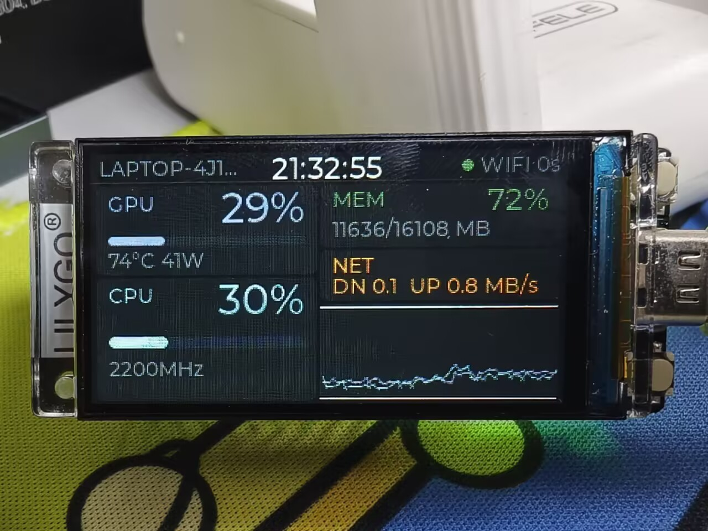

# 一块吃灰的 1.9 寸屏，怎么变成电脑性能仪表盘

> 状态说明：这是边做边写的记录，现在**屏幕已经点亮、USB 实时链路也跑通了**。
> 文中「点亮后画面」相关结论来自实机（2026-11-10，用户确认「画面完全对了」），
> 「CPU 压满 60 秒 → PC 端 97.5% / 屏上 90%+」是同一时刻的对照测试结果；
> 没发生的事（比如实测帧率）仍然不写，追溯不到的地方标 **未验证**。

## 一、起因：一块吃灰的屏

抽屉里躺着一块 LilyGO T-Display-S3：ESP32-S3、1.9 寸 IPS（170×320）、16MB Flash、8MB PSRAM，
丝印 `H569`。买的时候想的是「这么小一块屏，总会有地方用」，然后就一直吃灰。

真正让我动手的是个很日常的场景：跑编译、跑推理、玩游戏的时候，总想瞟一眼 CPU 占用、
GPU 温度、显存和功耗。切任务管理器太慢，开一个悬浮窗又太丑，而且悬浮窗还得占一块屏幕。
目标因此很具体：**桌角一块 320×170 的横屏仪表盘，一秒刷新一次，插上就能用。**
板子是横着立在桌面，所以 UI 按 320 宽、170 高来排，而不是把竖屏转 90 度糊上去。

现成的软件也不是没有，但都不合适：AIDA64 要付费；HWiNFO 免费版的共享内存有时长限制；
更关键的是，它们只能从自己的共享内存里取数，想同时走 USB 串口和 HTTP 两条链路就得自己写。
所以上位机自己来：一个 Python 守护进程 `pcmond`，一套 JSON，USB 和 HTTP 两种传输同时喂。

立项时定下几条规矩，后来一直没变：**先 USB 跑通再加 WiFi 双模**（USB 不用配网、不用连路由器，
是纯桌面场景的最优解）；横屏 320×170；框架用本机已装的 ESP-IDF 5.5.3；除了能跑，还要工程化
（自启、配置、README），并且开源。

## 二、先调研：微雪那个项目能抄吗？

按习惯，动手前先看别人怎么做的。参考项目是 `cc-usage-display`，我把它 clone 到本地读了源码：
`src/main.cpp` 782 行、`src/apps.cpp` 1268 行、`src/ui.cpp` 631 行，companion 的四个 Python 文件
分别是 110 / 102 / 321 / 193 行。读完之后结论就一句话：**架构能抄，驱动不能抄。**

能抄的是架构。它是个「PC 端 Python Companion 读本地数据源 → 局域网 HTTP + Bearer Token →
设备轮询渲染」的结构，设备侧 15 秒拉一次，60 秒无操作熄屏，还有一整套串口调试命令。
这个「采集与显示分离、走局域网、Token 鉴权」的骨架非常干净，直接沿用。

不能抄的是硬件层，而且不是小改，是整层重写。参考项目那块板子是微雪
**ESP32-C6-Touch-AMOLED-2.16**，和我手里的完全是两类东西：

| | 参考项目 | 本项目 |
|---|---|---|
| 屏幕 | 480×480 AMOLED | 1.9″ 170×320 ST7789 IPS |
| 总线 | QSPI | **8-bit Intel 8080 并口** |
| 触摸 | 有（CST9220） | 无 |
| 电源管理 | AXP2101 PMU | 无，只有一个 `LCD_POWER_ON` 使能脚 |
| 其它外设 | QMI8658 IMU、PCF85063A RTC | 无 |
| 框架 | Arduino / PlatformIO | ESP-IDF 5.5.3 |

连分辨率都反着来（480 方屏 vs 320×170 横条），UI 一行都复用不了。所以路线定成：
**架构思想沿用，驱动从零写；传输从「设备轮询 HTTP」改成「USB CDC 推送为主 + HTTP 轮询备用」**
——1Hz 的数据量很小，一根 USB 线供电加传数据，插上就能用，比配 WiFi 靠谱。

这一步的时间花得值得：先分清哪些能搬、哪些不能搬，后面就不会在别人的驱动代码里绕圈子。

## 三、五个关键技术点

### 3.1 这屏根本不是 SPI 的

拿到板子第一件反直觉的事：它的屏**不走 SPI**，走的是 8 位 Intel 8080 并口。数据线 D0–D7 是
GPIO39/40/41/42/45/46/47/48，WR（也就是 i80 的 PCLK）在 GPIO8，DC 在 GPIO7，CS 在 GPIO6，
RST 在 GPIO5，背光在 GPIO38，像素时钟最后定在 **16MHz**（官方 LilyGO 配置值，一开始按 20MHz 试）。
另外还有两根「看起来不用管、其实会出事」的线：**`LCD_POWER_ON`（GPIO15）**要单独拉高、
**RD（GPIO9）**要驱动成高电平（后者后面单独讲）。并口占了 13 个 GPIO，但一次传 8 位，
刷屏不吃力；板子的走线既然这么接，就顺着它来。

为什么选 ESP-IDF：它的 `esp_lcd` 自带 i80 总线，而且官方就有
`examples/peripherals/lcd/i80_controller/` 示例，里面正好是 ST7789 面板初始化、内置的
LVGL 9.2.2 移植代码、`esp_lcd_i80_alloc_draw_buffer` 双缓冲，连 flush 回调里的 RGB565
字节交换都写好了。这基本就是为本项目准备的地基，省掉从零啃 8080 时序的成本。

**旋转是在初始化后一次写 MADCTL(0x36) 解决的**，没走 `esp_lcd_panel_mirror` / `swap_xy`：
BGR 位没有对应的 driver setter，而且重建 panel 会让 LVGL 缓存的 handle 悬空。
gap 和 invert 仍走 driver API。

另一个决定：**v1 不启用 PSRAM**，显存预算算得很紧：两块
`esp_lcd_i80_alloc_draw_buffer(320*40*2)` = **51.2 KB 内部 RAM**（`INTERNAL|DMA` 拿对齐），
LVGL 堆 64 KB 是静态 bss。启动后内部堆 ≈153 KB，扣掉 draw buffer 剩 **≈102 KB 给 WiFi / HTTP / USB**
——纯 HTTP 不开 TLS 时 lwIP + WiFi STA 峰值约 60–70 KB，够用；真报 heap 不足就把
`LCD_DRAW_BUF_LINES` 从 40 降到 24（一处改）。而 PSRAM 的 octal/quad 模式一旦配错，
是「开机直接失败」级别的风险，能不用就不用。

### 3.2 LVGL 9：不走组件管理器，把源码 vendor 进来

UI 用 LVGL 9.2.2。这里有个取舍：可以引 `esp_lvgl_port` 这类现成封装，也可以用官方示例里
自带的移植层（约 40 行）。我选了后者——层数少、代码看得见，出问题知道去哪找。

依赖获取方式也被迫改了。ESP-IDF 的组件管理器在本机连不上 `components-file.espressif.com`，
`idf.py` 直接报 `Cannot establish a connection to the component registry`。但诡异的是，
**同一个 URL 用 python 直接抓是 200，用 IDF 自带 venv 的 python 抓也是 200**——所以不是
网络不通，是组件客户端的 HTTP 请求有问题。官方示例因此 configure 都过不了。

解法是放弃组件管理器：`tools/fetch_deps.cmd` 把 LVGL `v9.2.2` 浅克隆下来、裁剪后放进
`firmware/components/lvgl/`（这个目录 gitignore 掉，不进仓库）。代价是每个 clone 都要跑一次
依赖脚本、工程多十几 MB 源码；好处是**完全离线可复现**，也不受 registry 抖动影响。

裁剪时踩了个很典型的坑：LVGL 的 `env_support/cmake/esp.cmake` 会把 `examples/`、`demos/`
**无条件**加进 include 路径，你以为「用不到删掉省空间」，结果 CMake 直接报
`Include directory ... is not a directory`。只能把两个目录留着（可以是空的）。

### 3.3 USB CDC「一线通」：一根线搞定供电、数据、日志

ESP32-S3 有原生 USB-Serial/JTAG（D-/D+ = GPIO19/20），板上没有外置串口芯片。
这意味着插一根 USB-C 线，同时得到三样东西：供电、数据通道、以及看日志的串口。
对桌面摆件来说这是最舒服的形态——不用配网、不用开什么软件，插上就有数。

协议上做了个反直觉但很实用的选择：**不上二进制协议，就发一行 JSON**。每帧一行、`\n` 结尾、
UTF-8 无 BOM，契约上限 600 字节，实测一帧 **424 字节**（`host` 正好 15 字符卡满、`gpu.name`
34 字符被截到 19），字段全部可选，缺了就显示 `--`：

```json
{"v":1,"seq":42,"t":1762761600,"host":"MY-PC",
 "cpu":{"avg":23.4,"mhz":2400,"temp":null,"cores":[12,34,5,0]},
 "mem":{"pct":61.2,"used":9340,"total":15288},
 "gpu":{"util":16,"temp":58,"vram_used":1864,"vram_total":8151,"power":29.2},
 "net":{"down":1.2,"up":0.3},"disk":{"read":0.4,"write":2.1},"src":"usb"}
```

（契约里的示例帧，不是实测日志。）为什么这么干：1Hz、600 字节对 USB CDC 来说带宽上毫无压力，
换来的是**可读、可 `grep`、两端共用一份契约**，调试时不用为了「这帧到底对不对」再写一个解析器。
设备侧只在 `src` 字段里自己填 `usb` 或 `wifi`，两条链路报文字节完全相同。

USB 收数据还有个不装不行的坑：**不能读 console 的 stdin**。USB-Serial/JTAG 的 RX FIFO 只有 64 B，
一帧 424 B 的突发写入会丢字节；要用 `usb_serial_jtag_driver_install()`（rx 4096）→
`usb_serial_jtag_vfs_register()` → `usb_serial_jtag_vfs_use_driver()`，
让 esp_log 的 TX 和 JSON 行共用同一把锁，日志才不会把数据行切碎。串口调试命令是一整套：
`cfg` / `wifi <ssid> <pass>` / `url <url>` / `token <tok>` / `lcd [0-3]` / `reboot` / `help`。

上位机 `pcmond` 只依赖 psutil + pyserial，结构上刻意把采集和传输解耦：采集线程固定周期产出一帧
塞进 `queue.Queue(maxsize=2)`，队列满丢最旧帧，**采集永不阻塞**；USB 和 HTTP 各自读最新快照，
HTTP 的 `/api/stats` 只回最近一帧、不为每个请求重新采集。串口拔掉指数退避重连；
`nvidia-smi` 不存在或超时（3 秒）就让 GPU 字段整体发 `null`；端口被占只关 HTTP，
采集和 USB 继续跑——一句话，**任何单点故障都不许拖垮整个进程**。

### 3.4 状态机：怎么保证「绝不显示过期数据」

这类仪表盘最容易翻车的地方不是画不出来，而是**数据早就断了，界面还在显示旧数字**。
串口线松了、PC 睡眠了、WiFi 掉线了，屏幕上那个「CPU 23%」可能已经是十分钟前的。
用户不会去核对，他会信。所以设备侧的「新鲜度 + 仲裁」逻辑我没有直接写 `if`，
先用 logicprobe 建模验证了一遍（模型在 `docs/design/link-state-machine.model.json`）。

状态是：`INIT` / `NO_LINK` / `ONLINE_USB` / `ONLINE_WIFI` / `STALE` / `SLEEP`（深睡终态），
阈值 3 秒：3 秒没有新帧就进 `STALE`，界面标灰、状态灯变色。三轮才验证通过，
过程本身比结论更值钱：

- **v0，6 error。** 第一个错误很典型：我写了条 `stale-marked` 不变式（要求 `STALE` 时
  `age==3`），而 schema 规定 init 状态**无条件**参与 `var-in-range` 检查，`min=3` 在初始状态
  就必挂。第二个是运行态是个**封闭 SCC 且没有终态**，liveness 直接不过。第三个是
  `maxTicks=2` 被判「驻留超期」。
- **v1，4 error。** 补了 `SLEEP` 终态解决 SCC、删了那条不变式、把 `maxTicks` 提到 3——
  A14 仍然报 `ticks=4`。
- **v2，pass_with_findings，0 error / 21 warning。** 这时候才想通：**A14 的驻留计数不会因为
  `usb_frame` 重置 `age` 而清零**，而「数据一直在流就一直在 ONLINE」本来就是正确行为，
  驻留时长天然无界。`maxTicks` 表达不了「断流 3 秒内转 STALE」这件事，删掉它，改用
  `age` 守卫 + `var-in-range` 不变式来覆盖。

最后跑过的检查包括可达性、无死锁、活跃性、确定性、守卫完备、三条不变式、变量域，
以及一堆对抗性检查。**21 条 warning 全是设计使然**：10 条是「该状态下不可能发生的事件被忽略」
（比如非 INIT 状态收到 `boot_done`），1 条是「帧与 tick 的到达顺序会影响结果」——这是物理事实，
不是 bug。结论是这台状态机可以照着写代码了：「绝不在旧数据上显示在线」「3 秒断流转 STALE」
「USB 优先」三条硬要求都有可执行模型背书。

实现上还补了一个细节：USB 在线时 Wi-Fi 帧是**显式忽略**（seq 和 age 都不动，不是「只刷新」），
HTTP 轮询整轮跳过——这样状态灯不会在数据其实来自 Wi-Fi 时长亮 USB。

顺便说个心得：**这种小状态机值得建模，恰恰因为它小**——人脑觉得「就几个 if」所以不验证，
而真正难想全的正是 init 状态、守卫边界、死锁这些角落。

### 3.5 没有板子，也能把状态机真跑一遍

链路层两块核心逻辑——新鲜度状态机和「帧 JSON → `stats_t`」解析——都是纯 C，不碰 GPIO / LCD /
Wi-Fi，所以完全可以编到 PC 上跑。`firmware/test/host_link/` 干的就是这件事：把固件里**真实的
`link.c`**（不是复制品）用 MinGW 配 FreeRTOS / esp_log / esp_err 的 shim + IDF 自带 cJSON
编成主机程序——

```bash
GCC=/path/to/mingw64/bin/gcc.exe bash firmware/test/host_link/run.sh
```

结果 **61 checks, 0 failure**：状态机全部迁移（INIT 丢帧、USB/WiFi 抢占、3 个 tick 转 STALE、
USB 在线时 Wi-Fi 帧被忽略、SLEEP 终态吃帧不动）、`ONLINE_* 时 age ≤ 2` 不变式、
`frame.json` 里 424 B 的真实上位机帧解析、40 核截断到 32、占用率越界夹取、坏 JSON 拒收。

它的边界也要说清楚：跑的是 x86 代码，`xSemaphore` 在 shim 里是空实现，真实 RTOS 的竞态和栈溢出
测不到，也不覆盖 LCD / Wi-Fi / NVS。但这条路径的价值在于——**模型验证回答「设计对不对」，
主机测试回答「代码是不是真的那么走」**，而且改状态机或解析器时不用等板子。

## 四、踩坑集：现象 → 根因 → 解法

**坑 1：`LCD_POWER_ON` 不拉高，屏永远不亮。**
现象：背光 PWM 调得再对，屏幕也是黑的。根因：这块板的屏电源使能在 GPIO15
（`LCD_POWER_ON`，高有效），跟背光是两回事。解法：初始化流程里第一步就把它拉高。
说明：这是上板前就核对出来的硬件前提，实机点亮时按它做没出问题；没有它就没有后面的故事。

**坑 2：`idf.py` 报「python.exe doesn't exist」，但 python 明明存在。**
现象：在 bash（Git Bash/MSYS2）里 export 了 IDF 环境变量后，`idf.py` 报
`python.exe doesn't exist! Please run the install script`。根因：MSYS 会改写/弄丢环境变量里的
Windows 路径，`IDF_PYTHON_ENV_PATH=D:\...` 传过去已经变形；另外
`idf_tools.py export --format key-value` 输出的 `PATH` 是分号形式，直接 export 进 bash 会把
coreutils 全干掉（`head: command not found`）。解法：所有 IDF 构建改走 `cmd.exe` 批处理
（`tools/idf_build.cmd`），bash 只留一层包装（`tools/build.sh`）。还有个补丁：导出的 `PATH`
**不带 System32**，`xcopy`/`dir` 会找不到，必须在导出后 `set "PATH=%PATH%;%PATH_ORIG%"` 拼回来。

**坑 3：`.cmd` 里写中文，整段批处理崩掉。**
现象：`tools/idf_build.cmd` 一运行就报 `'f_build.cmd' 不是内部或外部命令`，还把注释里的
`tools\idf_build.cmd [build|flash|...]` 当命令执行（`|` 被当管道）。根因：cmd.exe 按 **cp936**
解析批处理文件，UTF-8 中文注释变成乱码字节，`rem` 行内容被当成命令。解法：**所有 `.cmd` /
`.bat` 一律纯 ASCII，注释也用英文**；bash 脚本不受影响，中文随便写。

**坑 4：Windows 上 `SO_REUSEADDR` 的语义和 Linux 相反。**
现象：开了两个 pcmond 实例，两个都「正常启动」，但 HTTP 请求时好时坏。根因：`socketserver`
的 `allow_reuse_address = True` 在 Linux 上是「TIME_WAIT 后立即重绑」，在 Windows 上却
**允许第二个进程再绑同一个正在监听的端口**——于是两个实例静默抢 8787，谁也不报错。
解法：Windows 上改用 `SO_EXCLUSIVEADDRUSE`，非 Windows 才用 reuse。现在第二个实例会报
`WinError 10048` 并且只关 HTTP 链路，采集和 USB 继续跑，进程不退出。

**坑 5：`psutil.cpu_percent(interval=None)` 第一次调用永远返回 0.0。**
现象：`--once` 打印出来的 CPU 占用率是 0。根因：没有前一次采样作基准，首次调用只能返回 0.0。
解法：启动时先预热调用一次，再睡 0.25 秒开始正式采样；单测把调用顺序锁住了，
防止以后有人「优化」掉预热。

**坑 6：`--once` 里网络和磁盘速率总是 0.00，以为采集写错了。**
现象：单帧输出里 `net` / `disk` 都是 0.00。根因：速率是「累计计数器差分」，单帧时有效窗口
只有预热那 0.2 秒，静默机器上确实接近 0；跑起来后按 1 秒窗口差分就是真实值。
解法：不用改代码，先确认这是单帧的正常现象，再拿长时间运行的结果判断。

**坑 7：多人并行构建，`BUILD_DIR` 写相对路径会把 build 目录建到奇怪的地方。**
现象：给 `idf_build.cmd` 加 `BUILD_DIR` 支持后第一次用相对路径，build 目录跑到仓库根，
kconfgen 直接失败。根因：`-B` 和 `SDKCONFIG` 都按**调用者的 cwd** 解析，不是相对工程目录。
解法：传绝对路径（`%PROJ%\%BUILD_DIR%`）。改完 `BUILD_DIR=build-lead bash tools/build.sh`
实测通过，产物在 `firmware/build-lead/`，flash 参数 `--flash_size 16MB --flash_freq 80m` 正确。

**坑 8：Montserrat 字体里没有 ↓ ↑ 字形。**
现象（看源码时发现）：NET 卡片原本要显示 `↓ 1.2 ↑ 0.3`，但查了 vendored 字体的 `unicode_list`，
`0x2193` / `0x2191` 根本不在里面（`0xB0`「°」在）——真机上会渲染成方框。解法：改用 ASCII
`DN 1.2  UP 0.3 MB/s`。裁剪字体省空间，代价是符号得自己确认。

**坑 9：标定模式退出后，屏幕一直停在测试图。**
现象：静态推演发现——BOOT 长按退出标定后，UI 回不来。根因：测试图是**绕过 LVGL 直接写面板**的，
所以 `ui_update()` 里加了「测试模式就早退」的保护；而退出分支只置了强制重绘标志、没清 lcd 的测试
标志 → UI 一直早退，强制重绘被消费掉，屏就卡在测试图。更麻烦的是「标定中」有两个状态源
（main 的布尔量 + lcd.c 的标志），走串口 `lcd` 进入后，BOOT 开关会以为「要进入」其实已经在里面。
解法：① 新增 `ui_exit_test_mode()`，清标志 + 整屏 invalidate（测试图不是 LVGL 画的，
不整屏刷就只有变化的 label 重绘）；② 删掉 main 的布尔量，统一用 `lcd_test_pattern_active()` 判状态。
这是代码层抓到的一个真 bug，而且没上板就抓到了——**两个状态源迟早要打架**。

**坑 10：烧录有两道坎：先进不去下载模式，烧完又停在 ROM 下载器。**
现象：第一次烧录直接 `esptool` 报 `Write timeout`——出厂 GIF demo 的固件不读 USB CDC 接收通道，
同步字节被 NAK；按住 BOOT 再插 USB 进 ROM 下载模式才能写。写完还有第二层坑：ESP32-S3 原生 USB
的复位路径会把 GPIO0 拉低，烧完只能停在 ROM 下载器，`esptool run` 也只停在 bootloader。
解法：烧完执行 `esptool --before no_reset --after watchdog_reset flash_id`，靠看门狗复位跳回 App；
已固化进 `tools/idf_build.cmd`，现在一条 `bash tools/build.sh flash COM10` 完成「烧录 + 自动重启」。

## 五、最值钱的一个坑：LCD RD 浮空

屏幕点亮花了整个项目最久的时间，而且卡在一个**不会报错**的地方。

**现象。** `esp_lcd` 的初始化全部返回 `ESP_OK`，串口日志一切正常（`lcd init done`、
`lvgl task started`），背光也亮，但屏幕是「**一半白、一半花屏**」，刷纯色自检也一样花。
更迷惑的是屏上显示的是**上一版固件留在 GRAM 里的旧像素**——说明我们的写根本没进面板。

**怎么二分。** 在 `main.c` 加开机自检（`BOOT_DISPLAY_SELFTEST`）：绕过 LVGL 和 panel 驱动，
直接发 `CASET/RASET/RAMWR + tx_color` 刷纯色。这里又踩了两个细节：① 第一版「一次设窗口、
多段续写」只有一小条变色——ST7789 在 CS 每次上升沿后不一定续写当前窗口，必须每块都重设窗口 +
重发 RAMWR；② 自检必须显式发 `SLPOUT(0x11)` + `DISPON(0x29)`，否则面板还在 sleep-in，
写进去也不显示。等自检刷出来还是「半白半花」，范围就从 LVGL/UI 缩到了总线上。

**根因。** **RD（读使能，GPIO9）浮空**。ST7789 的 RD 低有效，悬空时面板会朝 8 位数据总线反向驱动，
和主机的写操作抢总线 → 数据被打花，没覆盖到的区域保持上电随机值（发白）。而 ESP-IDF 的
`esp_lcd_i80_bus_config_t` **根本没有 `rd_gpio_num` 字段**，谁也没帮你管这根线；LilyGO 官方
Arduino 配置里 `TFT_RD 9` 是当普通输出脚驱动的。

**解法。** `lcd_init()` 之前 `gpio_config` GPIO9 为输出并 `gpio_set_level(9, 1)`；顺手把 PCLK
从 20 MHz 降到官方值 16 MHz。改完屏幕立刻出字，用户确认「画面完全对了」。

**教训。** 软件全对 ≠ 画面对。这类问题所有高层 API 都会告诉你 `ESP_OK`，只能靠「绕过高层驱动、
直接操作最底层」把嫌疑范围一步步缩小。这条现在写在 `docs/bringup.md` 黑屏排查表的第一行。

## 六、现状：点亮之后



拍这张照片时链路走的是 Wi-Fi：顶栏右侧那个绿点是状态灯，`WIFI 0s` 表示「Wi-Fi 在线、
距上一帧 0 秒」；GPU 卡片的 74 °C / 41 W 是 `nvidia-smi` 的真实读数，右下角那条曲线是 60 点历史。

**实机验证过的（2026-11-10，用户确认画面）**

- **屏幕**：320×170 横屏 UI 正常显示，用户确认「画面完全对了」。最终 ST7789 参数 = V0
  **MV + MX + invert + RGB + gap(0,35)**，i80 PCLK **16 MHz**。
- **实时链路**：USB CDC 1 Hz 推帧、`seq` 连续递增（60→63）；10 个忙循环压 CPU 60 秒时，
  PC 端 `pcmond --once` 读 **97.5%**，屏上 CPU 同步冲到 **90%+**。
- **数值对照**：同一时刻对比 PC 端 ground truth——MEM 74.7%（12026/16108 MiB）、
  GPU 24% / 70 °C / 2865/8151 MiB 全部一致；NET 空闲显示 0 是真 0，不是显示 bug。
- **烧录闭环**：一条 `bash tools/build.sh flash COM10` 完成烧录 + 自动重启，不用再手动拔插。

**还没验证的（发布前如实列出）**

- **CPU 温度**：14 代 HX 要 MSR/内核驱动，读不到，界面显示 `--`，v1 不承诺。
- **实际帧率 / 刷新率**：没测，不写估算值。
- **长时间稳定性**：1 Hz 连续推帧的长时间丢帧率、内存稳定性没压测（只验证了短时 `seq` 连续）。
- **NVS 持久化 / 深睡 / 第二页切页**：没逐项实测。
- **WiFi 断线重连 / 漫游**：只验证了「连上 AP + 正常轮询」，没测路由器重启、信号劣化、跨 AP 漫游。
- 编译仍是 0 error / 0 warning（约 1.18 MB、3 MB 分区剩 61%），离线测试 61 checks，上位机 90 单测。

顺带记一条被证伪的怀疑：一开始以为「屏上数字和 PC 对不上」，其实是对比时刻不同——CPU/GPU 每秒
都在波动，拿某一秒的屏上数字去比另一秒的 PC 采样必然对不上。改用「人为加压 → 看屏是否同步冲高」
这种**定性对照**才靠谱，这个经验对以后调监控类项目很有用。

后续计划：① 实机压测 USB 长时间稳定性；② 补点亮照片和外壳；③ 把开机自启在真机上复测一遍；
④ WiFi 断线重连与漫游场景。

仓库地址：**<https://github.com/landesou/tdisplay-s3-pc-monitor>**（本仓库采用 **MIT** 许可，
版权署名 `T-Display-S3 PC Monitor contributors`）。相关文档：架构与接口契约在
`docs/design/architecture.md`，开发日志在 `docs/journal.md`，上板清单在 `docs/bringup.md`，
上位机用法在 `companion/README.md`。

## 七、写在最后

这个项目是边做边记录的：`journal.md` 里每个决策、每条报错原文、每个「当时为什么这么选」都留着，
这篇博客基本是从它摘出来的。好处是写文档的时候不用凭记忆——报错原文、版本号、测试结果
都能直接引用；坏处是日志越写越长，但比起「三个月后想不起来为什么不用另一个方案」，这点长度不算什么。

最后一句实话：这项目最花时间的不是写驱动，也不是环境，而是那块「半白半花」的屏幕——它不报错，
却把整条链路堵在最后一步。如果你也在 Windows 上折腾 ESP-IDF，或者正对着一块花屏的 ST7789 发呆，
希望上面几个坑能帮你省一个晚上。
